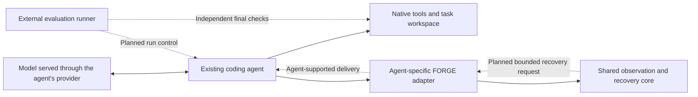

# FORGE product and adapter architecture

Decision: 2026-11-06 (Asia/Singapore).

FORGE is a recovery adapter layer around existing coding agents. Its shared core
tracks file/read/attempt evidence; an adapter connects that core to each agent's
native events and controls. OpenCode is the first implemented observation adapter.
Additional integrations are product milestones, not current compatibility claims.

The existing agent continues to own its model connection, coding loop, tools,
conversation history, permissions, and native safeguards. FORGE's planned recovery
policy requests bounded actions through that agent's supported controls. The
separate evaluation runner will launch experiments and verify final outcomes.

## Ownership and scope

| Responsibility | Owner | Current state |
| --- | --- | --- |
| Model/provider connection and tool execution | Existing coding agent | FORGE does not supply a model client or coding loop |
| Native hook/event decoding, tool names, diagnostic recognition, read metadata | Agent adapter | OpenCode mapping implemented in `src/adapters/opencode.mjs` |
| File snapshots, capture limits, session/call isolation, read and attempt comparisons, JSONL | Shared observer | Implemented in `src/observer.mjs` |
| Recovery selection using normalized evidence | Shared recovery policy | Planned; ordinary program rules first |
| Recovery delivery and session cancellation | Agent adapter using native controls | Planned; verify each capability on each supported version |
| Task setup, budgets, comparison modes, final acceptance, aggregate costs | External evaluation runner | Planned; final answers stay outside agent/policy access |
| Tools used to develop FORGE | Development harness | Separate from the product and evaluated agents |

Supporting a local model and supporting a coding agent are different requirements.
A model server supplies inference; an agent supplies task execution. A new model
normally uses the existing agent's provider configuration. A new agent needs an
adapter with verified observation and control capabilities. Model API compatibility
alone does not establish FORGE compatibility or adequate tool-calling behavior.

There is no requirement that inference run on the development laptop. The user
reports that this machine cannot host the local model. Develop and test mechanisms
without a model here; live evaluation requires a separately available compatible
execution environment. Record its actual agent/model/server/host configuration.
An external service, paid compute, or a different evaluation model is an explicit
experiment choice, not a silent substitute for the declared configuration.

## Implemented internal observation contract

`createObserver(options)` returns the following asynchronous methods. Adapters
await them and retain native results and permissions. This is an internal module
interface, not a published HTTP service, CLI protocol, or stable external SDK.

| Method | Normalized input |
| --- | --- |
| `recordToolStart` | `sessionID`, `callID`, native `tool` label, native `args`, optional normalized `target` |
| `recordToolFinish` | Same identity; fallback `args`/`target` when no start was captured; `status`, `text`, `source`, optional `candidate` and successful-read evidence |
| `recordSessionError` | `sessionID` and error evidence |
| `recordUsage` | `sessionID`, `messageID`, `modelID`, `providerID`, cumulative `tokens` and optional `cost` |
| `recordModelParameters` | `sessionID`, model/provider IDs and observed sampling/output limits |
| `dispose` | Flush observations and record pending-call count |

Required session/call/message identities and tool labels must be non-blank
strings; tool terminal status must be `completed` or `error`. The core validates
these before writing or changing call/history state. Invalid input disables
observation with a warning, preserves the valid log prefix, and leaves native
execution intact. It does not invent an identity or a successful shutdown record;
the retained prefix is an incomplete measurement. Session errors may omit a
session ID, because they can be global. Optional model/provider/usage fields may
remain null. These checks do not validate every native payload.

Disposal drains work queued before the first call and emits at most one shutdown
record. Repeated calls return the same promise. New observations are ignored once
disposal starts; the adapter also skips native payload mapping after that point.
Pending tools remain incomplete evidence, and disposal does not cancel native
execution. Logging failures stay passive and may leave no shutdown record.

`target` contains `filePath` and optional requested `offset`/`limit`. It is separate
from native arguments so another adapter can map a different tool schema without
changing the core. Only directly addressed in-workspace Python files within the
existing size limit are snapshotted. Omit an untrustworthy target rather than
guessing it from shell text. Successful `read` evidence contains requested
`offset`/`limit`, `returnedLines` when known, and `truncated` when known. Partial or
changed-during-read evidence keeps its uncertainty. Native read defaults belong
to each adapter; an unknown range remains null in the shared core.

The adapter recognizes its native diagnostics and supplies candidate labels such
as `replacement_failed` or `python_syntax_candidate`. The core does not infer them
from OpenCode tool names or messages. Candidates still require manual review.
Call IDs must be stable and unique within a session; each observer instance belongs
to one adapter run. Do not merge unrelated agents into one observer instance.
Repeated events with the same session/call, tool name, and terminal status are
deduplicated even when their source or output text differs. A conflicting tool
name or terminal status disables capture with a warning before changing stored
call/history evidence. The valid prefix remains an incomplete measurement; FORGE
does not choose which conflicting report is correct. This check does not compare
every duplicate payload field. New call IDs and other sessions remain independent.

OpenCode's deployment entry point stays `.opencode/plugins/forge-observer.js` and
returns no hooks unless `FORGE_OBSERVE=1`. It delegates to the OpenCode mapper,
which translates hooks/events into the shared methods. The existing schema-1 log
fields and summary behavior remain compatible. `opencode_version` is a legacy
nullable field; actual agent and adapter versions belong in the run manifest.
Initialization, mapping, and I/O failures must leave native execution intact.

OpenCode read mapping retains returned line coverage only for a file display
with positive safe-integer endpoints in ascending order. Missing, malformed, or
empty ranges remain null; result text and requested limits do not supply missing
coverage. The truncation flag remains null unless native metadata supplies a
boolean. A native requested offset of zero maps to one, including terminal-only
capture; a zero limit is retained. These are mapping rules based on the
[versioned read implementation](https://github.com/anomalyco/opencode/blob/v1.18.23/packages/opencode/src/tool/read.ts),
not live verification of an installed agent.

`src/observation-log.mjs` validates the supported schema-1 log envelope and the
identity/status fields used by summaries. It reports missing/duplicate/reordered
tool and lifecycle evidence without changing native agent execution. A consistent
`closed` log is not proof of complete runtime capture or final task acceptance.
The summarizer retains incomplete measurement counts and issues; its exit codes
are 0 for closed records, 2 for incomplete records with JSON output, and 1 when
input is invalid or unreadable. Preserve that distinction in experiment records.
`session_error_records` counts observed session-error records, including repeated
and unattributed ones. It does not infer distinct incidents, acceptance, or native
failure frequency, and does not copy captured error payloads into summaries.

## Admission of another agent

Before implementing a second adapter, inspect that agent's actual integration
interface and record its supported versions. Verify session/call identity,
terminal success/error capture, workspace/file attribution, lifecycle failures,
and preservation of native behavior. Declare unavailable read/usage evidence as
unknown. Observation, recovery delivery, and cancellation are separate capabilities;
an observation-only adapter must not advertise active recovery or strict budgets.

Before claiming support across agents, demonstrate live native read-edit-test,
failure capture, and the claimed recovery/cancellation capabilities on a second
existing agent. Reuse the core and supported action semantics. A synthetic adapter
fixture tests the internal contract; it does not establish a second live integration.
Compare native/reactive/FORGE within each agent/model configuration. Changing the
agent or model at the same time cannot isolate FORGE's recovery effect.

The first release may be an explicitly scoped OpenCode preview. The planned
portable release needs a published capability matrix and evidence for at least two
existing agents. Universal agent/model compatibility remains unproven. Additional
adapters are selected from actual integration evidence and user need; building a
new coding loop, model client, general orchestrator, or public service is outside
this product decision.

OpenCode's documented [plugin hooks](https://opencode.ai/docs/plugins/) and
[SDK controls](https://opencode.ai/docs/sdk/) inform the first adapter. They are
interface references, not evidence that the installed runtime has been exercised.
